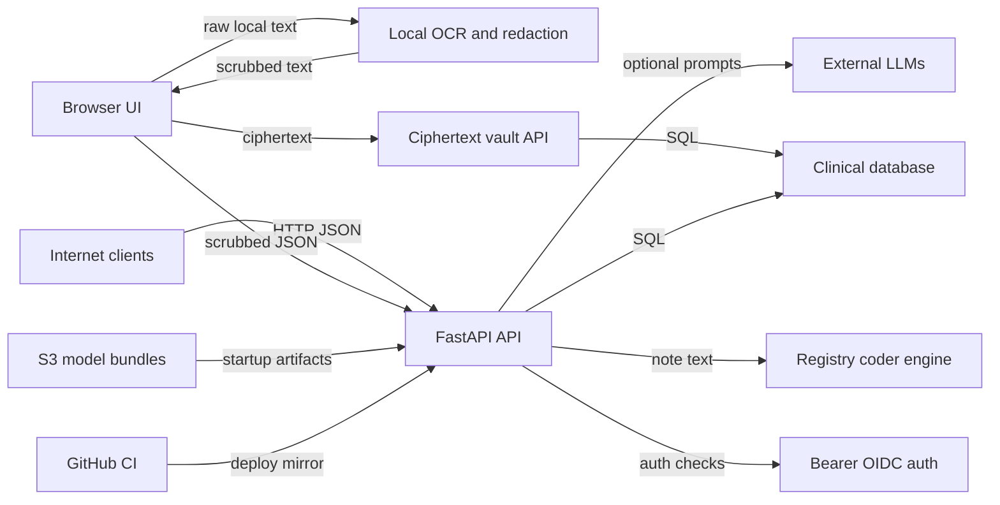

# Procedure Suite Threat Model

## Executive summary
Procedure Suite is moving toward a strong zero-knowledge architecture: the browser performs PHI detection, date translation, PDF/OCR extraction, and client-side vault encryption before sending scrubbed clinical text to a stateless extraction/coding backend. For an internet-exposed production deployment, the highest-risk areas are the current unauthenticated clinical routes, raw PHI ingress paths that can proceed when redaction fails, unauthenticated PHI re-identification/demo routes, optional external LLM egress before legal/BAA approval, and production exposure of dev/debug persistence and trace surfaces. The main mitigation theme is to make production fail closed: Bearer/OIDC on every clinical route, scrubbed-only ingress, LLM egress disabled until approved, route-level production allowlists, strict CORS/CSP, and supply-chain integrity checks for model/static bundles.

## Scope and assumptions
In-scope paths:
- Runtime FastAPI composition and routers: `app/api/fastapi_app.py`, `app/api/routes/`, `app/api/routes_registry.py`, `app/api/ml_advisor_router.py`.
- Auth, PHI, vault, persistence, LLM, and readiness helpers: `app/api/auth.py`, `app/api/phi_redaction.py`, `app/api/phi_dependencies.py`, `app/phi/`, `app/registry_store/`, `app/common/llm.py`, `app/reporting/speech_support.py`, `app/api/bootstrap.py`, `config/startup_settings.py`.
- Browser zero-knowledge workflow: `ui/static/phi_redactor/`, especially `app.js`, `vaultClient.js`, `caseSnapshotStore.js`, and `pdf_local/`.
- Deployment/build/CI paths: `ops/devserver.sh`, `ops/railway_start.sh`, `ops/railway_start_gunicorn.sh`, `ops/tools/bootstrap_*bundle.py`, `app/registry/model_bootstrap.py`, `.github/workflows/`.
- Existing security notes: `docs/CMIO_UCSD_PHI_SECURITY_BRIEF_2026-03-04.md`, `docs/DEPLOY_RAILWAY.md`, `docs/Production_Readiness_Review.md`.

Out-of-scope items:
- A full HIPAA legal compliance opinion, vendor BAA adequacy review, or cloud account/IAM review outside this repository.
- A cryptographic proof of the client-side vault design beyond repository-level control review.
- Dynamic penetration testing of a live deployment.
- Complete dependency vulnerability triage.

Explicit assumptions:
- The target deployment is internet-exposed production.
- All clinical APIs are expected to require Bearer/OIDC authentication and server-side authorization.
- `X-User-Id` is acceptable only for local development or tightly controlled transitional testing, not production.
- Any outbound LLM call carrying clinical text, even scrubbed text, is a blocker until legal/BAA approval is complete.
- Raw PHI, scrubbed clinical notes, derived registry/coding outputs, feedback/corrections, and vault metadata are sensitive clinical data.
- The browser is intended to be the normal PHI boundary; server-side raw PHI handling is legacy, demo, or emergency fallback risk unless explicitly approved.

Open questions that could change ranking:
- Whether the production app will physically exclude legacy/demo/debug routers, or only gate them by environment variables.
- Whether production persistence of scrubbed note text is approved for pilot, or whether production should be stateless-only.
- Which OIDC issuer, tenant model, and RBAC roles will be used for clinical users, support users, auditors, and service accounts.
- Whether the static UI and API share an origin in production, or whether the UI is served from a separate frontend service.

## System model
### Primary components
- Public FastAPI API and static UI host. Evidence: `app/api/fastapi_app.py:app`, `app/api/fastapi_app.py:app.add_middleware(CORSMiddleware, allow_origins=["*"])`, router includes for `unified_process_router`, `process_bundle_router`, `vault_router`, `reporting_router`, `qa_router`, `ml_advisor_router`, and `phi_router`.
- Client-side PHI redactor and clinical dashboard. Evidence: `ui/static/phi_redactor/app.js` runs worker-based detection via `worker.postMessage({ type: "start", text: originalText, ... })`, applies `[REDACTED]`/`[DATE: ...]` replacements in `buildRedactedText`, and sends `/api/v1/process` payloads with `already_scrubbed: true`.
- Browser-local PDF/OCR pipeline. Evidence: `ui/static/phi_redactor/pdf_local/workers/ocr.worker.js` imports same-origin `pdfjs` and `tesseract` assets from `../../vendor/...`, sets `workerBlobURL: false`, and performs OCR in a worker.
- Client-side encrypted vault. Evidence: `ui/static/phi_redactor/vaultClient.js:initNewVault`, `unlockVault`, `encryptPatientData`, and `encryptVaultJson` use WebCrypto AES-GCM and PBKDF2; `/api/v1/vault` stores wrapped keys and ciphertext through `app/api/routes/vault.py`.
- Stateless extraction/coding pipeline. Evidence: `app/api/routes/unified_process.py:unified_process` and `app/api/services/unified_pipeline.py:run_unified_pipeline_logic` run redaction, `RegistryService.extract_fields`, deterministic CPT derivation, evidence building, and financial calculations.
- Registry persistence and longitudinal case flows. Evidence: `app/api/routes/registry_runs.py`, `app/api/routes/registry_append.py`, `app/api/routes/registry_case.py`, and `app/registry_store/models.py`.
- Server-side PHI vault/demo service. Evidence: `app/api/routes/phi.py` exposes `/v1/phi/*`, `app/phi/service.py` handles vault/reidentify behavior, and `app/phi/models.py` stores `PHIVault.encrypted_data` plus audit logs.
- Reporting and optional speech/LLM support. Evidence: `app/api/routes/reporting.py:/report/seed_from_text`, `/report/transcribe_audio`, `/report/clean_seed_text`, and `app/reporting/speech_support.py`.
- External LLM clients. Evidence: `app/common/llm.py:OpenAILLM.generate`, `app/common/llm.py:GeminiLLM.generate`, and `app/reporting/speech_support.py:transcribe_reporter_audio`.
- Model and UI asset bootstrap. Evidence: `ops/railway_start_gunicorn.sh` calls S3 bootstrap scripts; `ops/tools/bootstrap_phi_redactor_vendor_bundle.py`, `ops/tools/bootstrap_granular_ner_bundle.py`, and `app/registry/model_bootstrap.py` download S3 artifacts and extract tarballs.
- CI and deploy mirror. Evidence: `.github/workflows/ci.yml` runs tests/lint/evals; `.github/workflows/deploy-mirror-sync.yml` builds and pushes a deploy mirror using `DEPLOY_MIRROR_PUSH_TOKEN`.

### Data flows and trust boundaries
- Internet client -> FastAPI API. Data: JSON clinical text, scrubbed notes, audio uploads, registry JSON, vault ciphertext, Bearer tokens. Channel: HTTPS in production assumption. Security guarantees today: FastAPI schema validation and readiness gating on many routes; global CORS is open in `app/api/fastapi_app.py`. Auth is present only on selected routers via `app/api/auth.py:get_current_user`, not globally.
- Browser UI -> browser workers. Data: raw note text, raw PDF bytes, OCR text, redaction spans. Channel: same-origin JavaScript worker messaging. Security guarantees today: client-local processing and vendored same-origin OCR/model assets; no server-side transport for raw PDF bytes in the normal PDF path. Validation: UI redaction spans and date replacement logic in `ui/static/phi_redactor/app.js`.
- Browser UI -> `/api/v1/process` and `/api/v1/process_bundle`. Data: scrubbed clinical text, registry UUIDs, relative date tokens, extraction options. Channel: HTTP JSON. Security guarantees today: client sets `already_scrubbed=true`; bundle route rejects absolute date-like strings; no route-level auth dependency on these endpoints.
- Browser UI -> `/api/v1/vault/*`. Data: wrapped VMK, ciphertext, IVs, registry UUIDs, user identity header or Bearer token. Channel: HTTP JSON. Security guarantees today: `get_current_user` supports Bearer JWT and disables `X-User-Id` fallback in production unless overridden; server stores ciphertext only and validates base64/IV/KDF bounds.
- FastAPI -> PHI/registry database. Data: encrypted raw PHI in PHI vault, scrubbed notes, registry outputs, corrections, feedback, vault ciphertext/settings. Channel: SQLAlchemy DB connection. Security guarantees today: encryption adapter for PHI vault defaults to Fernet but requires key; registry store comments require scrubbed-only; some persistence routes run a lightweight PHI scanner.
- FastAPI -> registry/coder/ML runtime. Data: scrubbed or raw note text depending on caller flags and redaction success, registry/coding outputs, evidence spans. Channel: in-process CPU executor. Security guarantees today: startup validates extraction-first production invariants; readiness checks gate many routes.
- FastAPI -> external LLM providers. Data: prompts containing clinical text or structured clinical data in optional paths. Channel: outbound HTTPS via `httpx`. Security guarantees today: offline flags and missing-key fallback; some routes require `already_scrubbed=true`; no global legal/BAA egress gate exists.
- FastAPI -> S3 model/vendor bundle sources. Data: model artifacts, OCR/vendor assets, tarballs. Channel: S3 API using runtime AWS credentials. Security guarantees today: S3 URI parsing and extension checks; no safe tar extraction or artifact signature/hash verification observed.
- GitHub Actions -> deploy mirror. Data: source payload and deployment artifacts. Channel: GitHub Actions token-based git push. Security guarantees today: workflow `contents: read` for repo checkout and separate mirror push token; no explicit secret scanning or artifact signing in observed workflows.

#### Diagram

## Assets and security objectives
| Asset | Why it matters | Security objective (C/I/A) |
|---|---|---|
| Raw PHI in user browser, OCR pipeline, `/v1/phi/*`, and `PHIVault.encrypted_data` | Direct patient harm, breach notification, HIPAA exposure | C: critical, I: high, A: medium |
| Scrubbed clinical notes and OCR-corrected text | Still sensitive clinical data and may include residual identifiers | C: high, I: high, A: medium |
| Registry/coding outputs, evidence spans, billing RVUs, CPT suggestions | Drives clinical registry and billing review decisions | C: high, I: high, A: high |
| Client vault password-derived keys, wrapped VMKs, ciphertext records, localStorage snapshots | Protects patient identity mapping and longitudinal case context | C: critical for keys/plaintext, I: high, A: medium |
| Bearer/OIDC tokens and service credentials | Allows access to clinical APIs and user-scoped data | C: critical, I: high, A: medium |
| External LLM prompts/responses and memory cache entries | May contain scrubbed clinical text; blocker until legal/BAA approval | C: critical before approval, I: medium, A: medium |
| PHI redactor/OCR/static UI assets | If modified, can exfiltrate raw browser-side PHI before redaction | C: critical, I: critical, A: medium |
| S3 model/vendor bundles and runtime model directories | Startup-loaded artifacts affect extraction integrity and static asset behavior | C: medium, I: critical, A: high |
| Registry run persistence, feedback, corrections, and training exports | Can leak sensitive scrubbed text and poison training/evaluation data | C: high, I: high, A: medium |
| Audit logs and observability data | Needed for incident investigation; may contain metadata | C: medium, I: high, A: medium |
| Availability of CPU/LLM/model workers | Public endpoints can exhaust expensive compute or vendor quotas | C: low, I: medium, A: high |

## Attacker model
### Capabilities
- Remote unauthenticated internet user can send HTTP requests to exposed FastAPI routes unless protected by route-level or gateway auth.
- Malicious website can cause a victim browser or automated client to call public API routes where CORS and browser credential behavior allow it; current global CORS allows all origins without credentials.
- Authenticated but low-privileged user can attempt cross-tenant access by changing registry UUIDs or identity headers.
- Attacker can submit large or adversarial clinical text, audio files within configured upload limits, registry JSON patches, feedback, corrections, and debug inputs.
- Attacker can attempt cost/availability abuse by repeatedly invoking CPU-heavy extraction, OCR cleanup, reporter seeding, speech transcription, and LLM-backed paths.
- A compromised build/deploy artifact source, S3 bucket/key, GitHub workflow secret, or static UI asset can affect production integrity.

### Non-capabilities
- The attacker is not assumed to have database administrator access, cloud console access, or the ability to read environment variables directly.
- The attacker is not assumed to know a user's vault password or client-side VMK unless browser JavaScript execution is compromised.
- The attacker cannot decrypt AES-GCM vault ciphertext merely by reading `/api/v1/vault` records without the user's password-derived key.
- The attacker cannot directly control operator-only environment variables such as `MODEL_BUNDLE_S3_URI_ONNX` unless deployment/configuration is compromised.
- The attacker cannot exploit external LLM provider infrastructure directly; the modeled risk is application egress of clinical data and cost/availability impact.

## Entry points and attack surfaces
| Surface | How reached | Trust boundary | Notes | Evidence (repo path / symbol) |
|---|---|---|---|---|
| Static UI `/ui/*` | Browser GET requests | Internet -> static UI/browser PHI boundary | Hosts PHI redactor and same-origin vendor assets; response headers include COOP/COEP and `Cache-Control: no-store`; no CSP observed in app wiring | `app/api/fastapi_app.py:_phi_redactor_headers`, `_phi_redactor_index_response` |
| Primary process `/api/v1/process` | HTTP POST JSON | Internet/browser -> API -> registry engine | Main extraction/coding path; no `get_current_user` dependency on route; accepts `already_scrubbed` flag | `app/api/routes/unified_process.py:unified_process`, `app/api/services/unified_pipeline.py:run_unified_pipeline_logic` |
| OCR correction `/api/v1/ocr/correct` | HTTP POST JSON | Browser -> API -> optional LLM | Requires `already_scrubbed=true`, then calls OCR cleaner | `app/api/routes/unified_process.py:correct_camera_ocr`, `app/text_cleaning/camera_ocr_cleaner.py` |
| Bundle process `/api/v1/process_bundle` | HTTP POST JSON | Browser -> API -> registry engine | Rejects absolute date-like strings; no route-level auth dependency | `app/api/routes/process_bundle.py:process_bundle` |
| Reporting `/report/*` | HTTP POST JSON or upload | Browser/internet -> API -> reporting/LLM | Routes for seed, render, questions, speech transcription, cleanup; no auth dependency observed | `app/api/routes/reporting.py` |
| PHI preview/submit/reidentify `/v1/phi/*` | HTTP JSON | Internet -> PHI service -> PHI DB | Includes raw PHI submit and raw PHI re-identification; no auth dependency observed | `app/api/routes/phi.py:submit_phi`, `reidentify_phi` |
| Registry run persistence `/api/v1/registry/runs*` and export | HTTP JSON/stream | Internet -> API -> registry DB | Feature-gated but unauthenticated; list/export marked admin-lite/no auth; get/export includes serialized `note_text` | `app/api/routes/registry_runs.py:list_registry_runs`, `get_registry_run`, `export_registry_runs` |
| Registry feedback/correction | HTTP POST/PUT JSON | Internet -> API -> registry DB | Mutates persisted run feedback and corrected payloads without auth | `app/api/routes/registry_runs.py:submit_registry_run_feedback`, `upsert_registry_run_correction` |
| User vault `/api/v1/vault/*` | HTTP JSON | Authenticated browser -> ciphertext API -> DB | Uses `get_current_user`; Bearer preferred, `X-User-Id` fallback disabled in production unless overridden | `app/api/routes/vault.py`, `app/api/auth.py:get_current_user` |
| Case append/get/patch/rebuild | HTTP JSON | Authenticated browser -> API -> DB | Append/case routes use `get_current_user` and check `UserPatientVault` ownership | `app/api/routes/registry_append.py:append_registry_document`, `app/api/routes/registry_case.py` |
| Legacy raw coder/registry | HTTP JSON | Internet -> legacy API -> registry/coder/LLM | Feature-gated by `PROCSUITE_ALLOW_LEGACY_ENDPOINTS`; some routes accept raw notes when enabled | `app/api/guards.py:enforce_legacy_endpoints_allowed`, `app/api/routes_registry.py`, `app/api/routes/legacy_coder.py` |
| Procedure code suggestions | HTTP JSON | Internet -> coding service | Accepts `report_text`; PHI review gate applies only in configured modes and UUID flows | `app/api/routes/procedure_codes.py:suggest_codes` |
| ML Advisor debug routes | HTTP JSON and GET trace export | Internet -> debug API -> filesystem | Legacy/synthetic-only docstring; trace logging default true; trace list/get/export endpoints expose `report_text` if traces exist | `app/api/ml_advisor_router.py:ENABLE_CODING_TRACE`, `log_trace`, `list_traces`, `export_traces` |
| QA sandbox `/qa/run` | HTTP POST JSON | Internet -> QA service -> extraction/reporter/coder | Accepts note text and runs modules; no auth dependency observed | `app/api/routes/qa.py:qa_run` |
| Metrics and UMLS | HTTP GET | Internet -> diagnostics/data lookup | Metrics can expose operational labels/status; UMLS suggests concepts | `app/api/routes/metrics.py`, `app/api/routes/umls.py` |
| S3 model/vendor bootstrap | Runtime startup | Deployment config -> S3 -> local filesystem/runtime | Downloads tarballs/prefixes and extracts/copies artifacts before serving | `ops/railway_start_gunicorn.sh`, `ops/tools/bootstrap_phi_redactor_vendor_bundle.py`, `app/registry/model_bootstrap.py` |
| GitHub workflows | GitHub events | Developer/CI -> build/deploy mirror | CI installs deps/tests; deploy mirror pushes payload with secret token | `.github/workflows/ci.yml`, `.github/workflows/deploy-mirror-sync.yml` |

## Top abuse paths
1. TM-001: Unauthenticated processing and CORS-enabled abuse. Goal: use the public service as an extraction/LLM compute oracle. Steps: attacker discovers `/api/v1/process`; sends clinical text or adversarial scrubbed-looking payloads; route runs registry/coder pipeline without Bearer/OIDC; attacker receives structured clinical/billing outputs or exhausts compute. Impact: confidentiality exposure if PHI is submitted, integrity risk in generated outputs, and availability/cost impact.
2. TM-002: Raw PHI reaches downstream processing when redaction fails. Goal: bypass the browser PHI boundary. Steps: attacker or misconfigured client sends raw text with `already_scrubbed=false`; server obtains no scrubber or scrubber throws; `apply_phi_redaction` logs a warning and returns raw text; raw text enters extraction and optional LLM-capable code paths. Impact: PHI disclosure and policy violation.
3. TM-003: Raw PHI re-identification through unauthenticated PHI routes. Goal: recover stored plaintext PHI. Steps: attacker obtains or guesses a `procedure_id`; posts to `/v1/phi/reidentify` with self-asserted user fields; service decrypts and returns `raw_text`. Impact: direct PHI breach.
4. TM-004: Registry run data exfiltration and tampering. Goal: read or corrupt persisted scrubbed clinical data. Steps: attacker uses unauthenticated `/api/v1/registry/runs` list/get/export when persistence is enabled; receives serialized run records including `note_text`; submits unauthenticated feedback or corrections. Impact: sensitive data exposure and training/evaluation poisoning.
5. TM-005: External LLM egress before legal/BAA approval. Goal: force clinical text to leave the controlled environment. Steps: attacker or misconfigured user invokes reporter seed, OCR cleanup, speech transcription, or extraction fallback with clinical text; optional LLM path posts prompt/audio to OpenAI-compatible or Gemini endpoint; legal/BAA approval is not represented as a hard runtime gate. Impact: policy blocker and potential reportable disclosure.
6. TM-006: Browser zero-knowledge boundary compromise through static asset or XSS compromise. Goal: steal raw note/PDF text before redaction. Steps: attacker gains ability to alter served UI JavaScript/vendor assets or inject same-origin script; malicious script reads editor/PDF/OCR/vault password state; data is exfiltrated before `[REDACTED]` processing. Impact: raw PHI and vault material compromise.
7. TM-007: Cross-user vault/case abuse if `X-User-Id` fallback is enabled in production. Goal: access or mutate another user's case records. Steps: attacker sends `X-User-Id` for a victim user; vault/case routes accept fallback if production override is set; attacker lists ciphertext or appends/patches records for known registry UUIDs. Impact: ciphertext confidentiality is partly preserved, but integrity, deletion, availability, and metadata privacy are harmed.
8. TM-008: DoS and cost exhaustion. Goal: degrade availability and consume model/vendor budget. Steps: attacker repeatedly calls unauthenticated CPU-heavy or LLM-adjacent endpoints (`/api/v1/process`, `/report/*`, `/qa/run`, ML advisor); each request consumes CPU workers, model memory, or upstream quotas. Impact: high service unavailability and direct vendor cost.
9. TM-009: Debug/legacy route PHI sink. Goal: create and retrieve PHI-containing traces or QA outputs. Steps: attacker sends raw report text to ML Advisor or legacy routes when enabled; trace logging writes `report_text` to `data/coding_traces.jsonl`; attacker retrieves traces through list/get/export. Impact: persistent sensitive data leak and dev/test surface exposure.
10. TM-010: Startup artifact compromise. Goal: run or serve malicious model/static assets. Steps: attacker compromises S3 artifact, mirror repo, or CI secret; startup downloads and extracts tarballs without safe extraction/signature verification; app serves or loads compromised assets/models. Impact: integrity compromise, possible static UI PHI exfiltration, and availability loss.

## Threat model table
| Threat ID | Threat source | Prerequisites | Threat action | Impact | Impacted assets | Existing controls (evidence) | Gaps | Recommended mitigations | Detection ideas | Likelihood | Impact severity | Priority |
|---|---|---|---|---|---|---|---|---|---|---|---|---|
| TM-001 | Remote unauthenticated internet user | Production API is internet-exposed and primary clinical routes are included without auth dependencies. | Calls `/api/v1/process` or `/api/v1/process_bundle` directly to process clinical text or consume compute. | PHI/scrubbed-note exposure if callers send sensitive text; compute/cost abuse; unauthenticated clinical decision support output. | Raw/scrubbed notes, registry/coding outputs, availability | Readiness gating in `app/api/readiness.py`; production startup invariants in `config/startup_settings.py`; client UI sends scrubbed text in `ui/static/phi_redactor/app.js`. | No `get_current_user` dependency on process/bundle routes; open CORS in `app/api/fastapi_app.py`; no visible rate limit. | Add a production auth dependency or middleware covering every clinical router; reject unauthenticated requests before body processing; configure CORS origin allowlist; add WAF/rate limits/quotas. | Alert on anonymous requests to clinical paths; log authenticated subject, route, body size, processing time, and 401/403 spikes without raw text. | High | High | critical |
| TM-002 | Remote user or misconfigured client | Client can send raw text or set `already_scrubbed=false`; server scrubber unavailable or throws. | Causes raw PHI to proceed through extraction/coding and optional downstream processing. | Direct PHI boundary failure and possible LLM/vendor disclosure. | Raw PHI, LLM prompts, logs, extraction outputs | UI redaction workflow and `already_scrubbed=true` in `ui/static/phi_redactor/app.js`; PHI dependency supports `PHI_SCRUBBER_STRICT`; CMIO brief documents scrubbed-only target. | `app/api/phi_redaction.py:apply_phi_redaction` returns raw text when scrubber is `None` or fails; `app/api/phi_dependencies.py` can fall back to `StubScrubber`. | In production, require `PROCSUITE_STRICT_ZK=1` behavior for all processing/reporting routes; reject `already_scrubbed=false`; make scrubber failures fail closed; disallow `StubScrubber` and demo encryption in production. | Metric on any `redaction_warning`; page on production `redaction_was_scrubbed=false` with `already_scrubbed=false`; test startup fails if strict scrubber unavailable. | High | High | critical |
| TM-003 | Remote unauthenticated internet user | PHI routes are included and PHI vault contains records; attacker has or can discover a `procedure_id`. | Calls `/v1/phi/reidentify` with self-asserted user fields and receives `raw_text`. | Raw PHI breach, audit trail polluted with attacker-supplied identity. | Raw PHI, PHI vault encryption boundary, audit logs | PHI data is encrypted at rest through adapters; audit model exists in `app/phi/models.py`; Fernet adapter requires `PHI_ENCRYPTION_KEY`. | `app/api/routes/phi.py:reidentify_phi` has no auth dependency or authorization check; request carries user identity fields supplied by caller. | Disable `/v1/phi/*` in production unless explicitly approved; require Bearer/OIDC auth plus RBAC for reidentifier role; bind procedures to users/cases; derive audit user fields from server-side identity only. | Alert on any reidentify call; require break-glass reason; immutable audit log; detect reidentify from non-approved roles. | High | High | critical |
| TM-004 | Remote unauthenticated internet user | `REGISTRY_RUNS_PERSIST_ENABLED=1` in an exposed deployment. | Lists, gets, exports, or mutates registry runs and corrections without auth. | Exposure of scrubbed notes and registry outputs; tampering with feedback/corrections and possible training data pollution. | Scrubbed notes, registry outputs, feedback, corrections, training/eval data | Feature flag in `app/api/routes/registry_runs.py:_enforce_registry_runs_enabled`; lightweight PHI scanner before persistence in `app/registry_store/phi_gate.py`. | List/get/export are marked admin-lite/no auth; `_serialize_run` includes `note_text`; feedback/correction are unauthenticated. | Require Bearer/OIDC and admin/reviewer RBAC; tenant-scope all run records; remove `note_text` from list/export unless privileged; sign correction history; default persistence off for internet prod unless approved. | Alert on exports, bulk reads, corrections, feedback submissions; monitor PHI scanner rejections and run counts per user. | Medium | High | high |
| TM-005 | Remote user, malicious client, or misconfigured operator | LLM provider keys are configured and optional paths enabled before legal/BAA approval. | Sends clinical text/audio to reporter seed, OCR cleanup, speech transcription, self-correction, or LLM fallback paths. | Contractual/compliance blocker and potential disclosure to vendor/subprocessors. | Clinical text, audio, prompts/responses, LLM cache | Offline/missing-key fallback in `app/common/llm.py`; `correct_camera_ocr` and speech cleanup require `already_scrubbed=true`; cloud speech requires explicit confirmation and env flag in `app/reporting/speech_support.py`. | No repo-wide "legal approved" egress gate; client boolean can be trusted; reporter seed applies fail-open redaction; LLM cache may hold outputs in memory. | Add a single production egress policy gate such as `PROCSUITE_LLM_EGRESS_APPROVED=1` plus provider allowlist; default all clinical-text LLM features off; block prompts containing PHI-risk patterns; document BAA/no-retention settings before enabling. | Log route/model/provider/request id and legal gate state, never prompt text; alert on any LLM call in production while gate is disabled. | High | High | critical |
| TM-006 | XSS attacker, compromised static asset, compromised deploy mirror/S3 bundle | Attacker can execute same-origin JavaScript or alter served UI/vendor assets. | Reads raw editor/PDF/OCR/vault state before redaction or captures vault password-derived material. | Breaks zero-knowledge boundary and leaks raw PHI/client vault plaintext. | Raw browser PHI, local OCR text, localStorage ciphertext, vault keys/password entry | Same-origin vendored OCR assets in `ui/static/phi_redactor/pdf_local/workers/ocr.worker.js`; service worker unregisters and clears cache in `ui/static/phi_redactor/sw.js`; static route prevents vendor path traversal in `app/api/fastapi_app.py`. | No CSP/SRI/asset signature evidence in app wiring; static UI shares trust with API origin; deploy mirror and S3 artifacts can affect served code/assets. | Add strict CSP with nonces/hashes and no inline/eval; sign and hash static/model bundles; separate UI and API origins if feasible; lock dependencies; add integrity verification for vendor assets; review all dynamic HTML injection points. | Monitor CSP violations, unexpected asset hashes, deploy mirror changes, and S3 object version changes; alert on UI asset drift. | Medium | High | high |
| TM-007 | Authenticated or unauthenticated user depending on config | `VAULT_AUTH_ALLOW_X_USER_ID=true` is enabled in production or static UI lacks JWT wiring. | Spoofs another user's `X-User-Id` to read ciphertext records, delete records, append events, or patch cases if registry UUIDs are known. | Vault ciphertext remains encrypted, but metadata, integrity, deletion, and case state can be compromised. | Vault records, registry case records, appended documents | `app/api/auth.py` prefers Bearer and disables `X-User-Id` fallback in production by default; vault/append/case routes use `get_current_user` and ownership checks. | Docs allow setting `VAULT_AUTH_ALLOW_X_USER_ID=true` for static UI troubleshooting; fallback is bearer-equivalent identity if enabled. | Remove `X-User-Id` fallback from production builds; require OIDC access tokens for static UI; enforce issuer/audience checks; add role and tenant claims; rotate any environments that used fallback publicly. | Alert if production receives `X-User-Id`; log auth method; add startup failure when `PROCSUITE_ENV=production` and fallback is true. | Medium | High | high |
| TM-008 | Remote unauthenticated internet user | Public routes perform CPU-heavy extraction, model warmup, reporter rendering, or optional LLM calls without auth/rate limits. | Repeatedly submits large or adversarial payloads to exhaust CPU workers, memory, LLM quota, or audio transcription budget. | Service unavailability and direct cost exhaustion. | Availability, LLM quota/budget, worker memory | Uvicorn/gunicorn concurrency settings in `ops/devserver.sh` and `ops/railway_start_gunicorn.sh`; LLM semaphore/cache in `app/infra/llm_control.py` and `app/common/llm.py`; audio max size in `app/reporting/speech_support.py`. | No global auth/rate limit/body size limit; many CPU routes are public; `UploadFile.read()` reads entire audio into memory within max size. | Enforce auth before request processing; gateway/body limits; per-user quotas; route-specific max note chars; queue long jobs; circuit breakers for LLM and speech; WAF bot controls. | Alert on high request rate, high 429/503, CPU worker saturation, LLM token spend, and repeated large bodies per subject/IP. | High | Medium | high |
| TM-009 | Remote user or internal tester with access to exposed debug routes | Legacy/debug routers are included in production or flags are enabled. | Sends PHI-like text to ML Advisor, QA, or legacy endpoints; traces/logs persist report text and export endpoints expose it. | Persistent sensitive data leak, route confusion, and unsupported logic exposure. | Raw/scrubbed notes, traces, QA outputs | Legacy raw routes are feature-gated by `app/api/guards.py`; ML Advisor docstring says synthetic-only; `ENABLE_ML_ADVISOR` default false. | `ENABLE_CODING_TRACE` default true in `app/api/ml_advisor_router.py`; trace list/get/export have no auth; QA route has no auth; routers are included unconditionally in `fastapi_app.py`. | Build a production router allowlist; exclude ML Advisor, QA, demo, and legacy routes from production app; set trace logging default false; add PHI scanner before any trace write; require admin auth for diagnostics. | Alert if debug routes are hit in production; track trace file growth; canary test production OpenAPI excludes debug paths. | Medium | High | high |
| TM-010 | Compromised S3 artifact, CI token, or deploy pipeline | Runtime uses configured S3 bundle URIs or deploy mirror payload. | Provides malicious tar/model/static assets; startup extracts/copies artifacts into runtime or UI vendor dirs. | Integrity compromise, static UI PHI exfiltration, model poisoning, startup failure, possible filesystem overwrite via tar paths. | Static assets, model runtime, deployment integrity, PHI boundary | S3 URI parsing and `.tar.gz` extension checks in bootstrap scripts; deploy mirror has `permissions: contents: read` and uses a distinct push token. | `tarfile.extractall` used without path traversal checks; no artifact signatures/checksums observed; runtime AWS credentials download artifacts. | Implement safe tar extraction; require signed artifact manifest with SHA-256; pin S3 object versions; use least-privilege read-only IAM; scan artifacts; fail closed on hash mismatch. | Alert on S3 object changes, bootstrap source URI changes, artifact hash drift, and deploy mirror pushes outside expected workflow. | Medium | High | high |
| TM-011 | Remote unauthenticated internet user | Metrics/UMLS/status endpoints are reachable publicly. | Queries operational status, metrics labels, model/readiness details, or UMLS concept store. | Reconnaissance, minor data leakage, possible operational metadata exposure. | Operational metadata, model/config status | Metrics can be disabled by env in `app/api/routes/metrics.py`; UMLS has limit <= 50 and enable flag in `app/api/routes/umls.py`. | No auth on metrics/status/UMLS; metric labels could reveal workflow names or drift information. | Put diagnostics behind admin auth or private network; redact labels; disable metrics JSON on public internet; expose Prometheus only to scrape identity/network. | Alert on external hits to diagnostics; monitor unexpected high-cardinality query patterns. | Medium | Medium | medium |

## Criticality calibration
Critical for this repo:
- Any unauthenticated path that can return raw PHI, such as `/v1/phi/reidentify`.
- Any production path that can send clinical text/audio to an external LLM before legal/BAA approval.
- Any production default that allows raw PHI to proceed downstream when redaction fails.

High for this repo:
- Unauthorized access to scrubbed notes, registry outputs, feedback, or corrections.
- Browser/static asset compromise that can read raw notes or vault plaintext before client-side redaction/encryption.
- Public CPU/LLM-heavy routes that can create material availability or cost impact.
- Startup artifact compromise that poisons models or served PHI redactor assets.

Medium for this repo:
- Diagnostics, metrics, UMLS, and status endpoints that expose operational metadata useful for reconnaissance.
- Cross-user vault/case integrity risk where ciphertext remains encrypted but records can be deleted or corrupted.
- Legacy/dev route exposure that is feature-gated but still present in the production composition root.

Low for this repo:
- Public access to non-sensitive health endpoints that do not expose configuration or clinical data.
- Static documentation or synthetic demo metadata that contains no patient data.
- Local-only dev convenience defaults when bound only to localhost and isolated from production data.

## Focus paths for security review
| Path | Why it matters | Related Threat IDs |
|---|---|---|
| `app/api/fastapi_app.py` | Composition root includes all routers and configures open CORS/static UI headers. | TM-001, TM-006, TM-009, TM-011 |
| `app/api/auth.py` | Central Bearer/JWKS and `X-User-Id` fallback behavior determines user identity trust. | TM-001, TM-007 |
| `app/api/routes/unified_process.py` | Primary clinical processing and OCR correction routes. | TM-001, TM-002, TM-005, TM-008 |
| `app/api/services/unified_pipeline.py` | Core redaction, extraction, CPT derivation, evidence, financials, and metadata flow. | TM-001, TM-002, TM-005 |
| `app/api/phi_redaction.py` | Fail-open redaction behavior can return raw text downstream. | TM-002, TM-005 |
| `app/api/phi_dependencies.py` | PHI service wiring, scrubber fallback, demo encryption mode, and DB URL selection. | TM-002, TM-003 |
| `app/api/routes/phi.py` | Raw PHI submit/review/reidentify routes without auth dependencies. | TM-003 |
| `app/phi/service.py` | Decryption, PHI vaulting, and audit behavior for raw PHI. | TM-003 |
| `app/phi/models.py` | PHI vault, procedure data, and audit schema. | TM-003 |
| `app/api/routes/process_bundle.py` | ZK multi-document flow and date-like string guardrail. | TM-001, TM-002, TM-008 |
| `app/api/routes/reporting.py` | Reporter seed/render/speech routes and LLM-adjacent flows. | TM-005, TM-008 |
| `app/reporting/speech_support.py` | Cloud transcription/cleanup gates, max upload size, PHI pattern checks. | TM-005, TM-008 |
| `app/common/llm.py` | OpenAI/Gemini clients, prompt egress, cache behavior, usage logging. | TM-005, TM-008 |
| `app/api/routes/registry_runs.py` | Unauthenticated stateful run persistence, export, feedback, and correction. | TM-004, TM-008 |
| `app/registry_store/models.py` | Defines scrubbed note and registry output persistence schema. | TM-004 |
| `app/registry_store/phi_gate.py` | Lightweight pre-persistence PHI scanner; not a full scrubber. | TM-002, TM-004 |
| `app/api/routes/registry_append.py` | Authenticated append flow, strict ZK gate, date guard, ownership check. | TM-007 |
| `app/api/routes/registry_case.py` | Authenticated case get/patch/rebuild and manual override integrity. | TM-007 |
| `app/api/routes/vault.py` | Ciphertext-only vault routes and size constraints. | TM-007 |
| `app/api/schemas/vault.py` | Base64, IV, KDF, and ciphertext validation. | TM-007 |
| `ui/static/phi_redactor/app.js` | Client PHI detection, redaction, forbidden local payload keys, process/append/persist calls. | TM-001, TM-002, TM-006, TM-007 |
| `ui/static/phi_redactor/vaultClient.js` | Browser crypto, localStorage encrypted records, server anchor migration, `X-User-Id` headers. | TM-006, TM-007 |
| `ui/static/phi_redactor/caseSnapshotStore.js` | Local encrypted longitudinal snapshots and chunked localStorage persistence. | TM-006 |
| `ui/static/phi_redactor/pdf_local/` | Browser-local PDF/OCR pipeline and same-origin asset dependency. | TM-006 |
| `app/api/ml_advisor_router.py` | Synthetic/legacy debug routes, trace writes, trace exports. | TM-009 |
| `app/api/routes/qa.py` | QA sandbox accepts note text and runs multiple modules. | TM-008, TM-009 |
| `app/api/routes_registry.py` and `app/api/routes/legacy_coder.py` | Legacy raw note routes, feature gates, and LLM-capable flows. | TM-002, TM-009 |
| `app/api/routes/procedure_codes.py` | Procedure code suggestion route can accept report text outside reviewed UUID flow depending on config. | TM-002, TM-009 |
| `ops/tools/bootstrap_phi_redactor_vendor_bundle.py`, `ops/tools/bootstrap_granular_ner_bundle.py`, `app/registry/model_bootstrap.py` | S3 download and tar extraction for runtime/static/model artifacts. | TM-010 |
| `.github/workflows/ci.yml` and `.github/workflows/deploy-mirror-sync.yml` | CI/deploy mirror behavior and secret-bearing push workflow. | TM-010 |

## Quality check
- Covered discovered runtime entry points: primary process, bundle, OCR correction, reporting, PHI, vault, registry runs, append/case, legacy coder/registry, procedure codes, ML Advisor, QA, metrics, UMLS, and static UI.
- Covered CI/build/dev separation: runtime HTTP threats are distinct from deploy mirror, S3 bundle bootstrap, devserver, and GitHub workflows.
- Covered each major trust boundary at least once: browser local PHI boundary, internet/API, API/database, API/model runtime, API/external LLM, API/S3 artifacts, CI/deploy.
- Incorporated user clarifications: internet-exposed production, Bearer/OIDC on all clinical routes, and clinical-text LLM egress blocked until legal/BAA approval.
- Marked assumptions and open questions that affect risk ranking.
- Did not inspect or disclose local `.env` secrets; evidence anchors reference source paths and symbols only.
